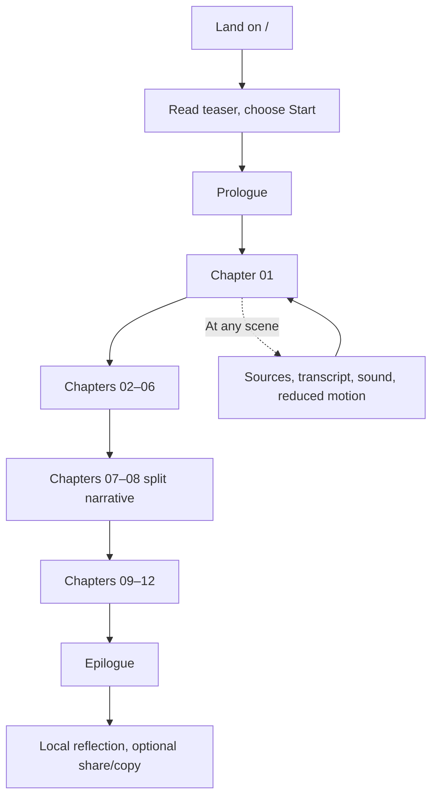
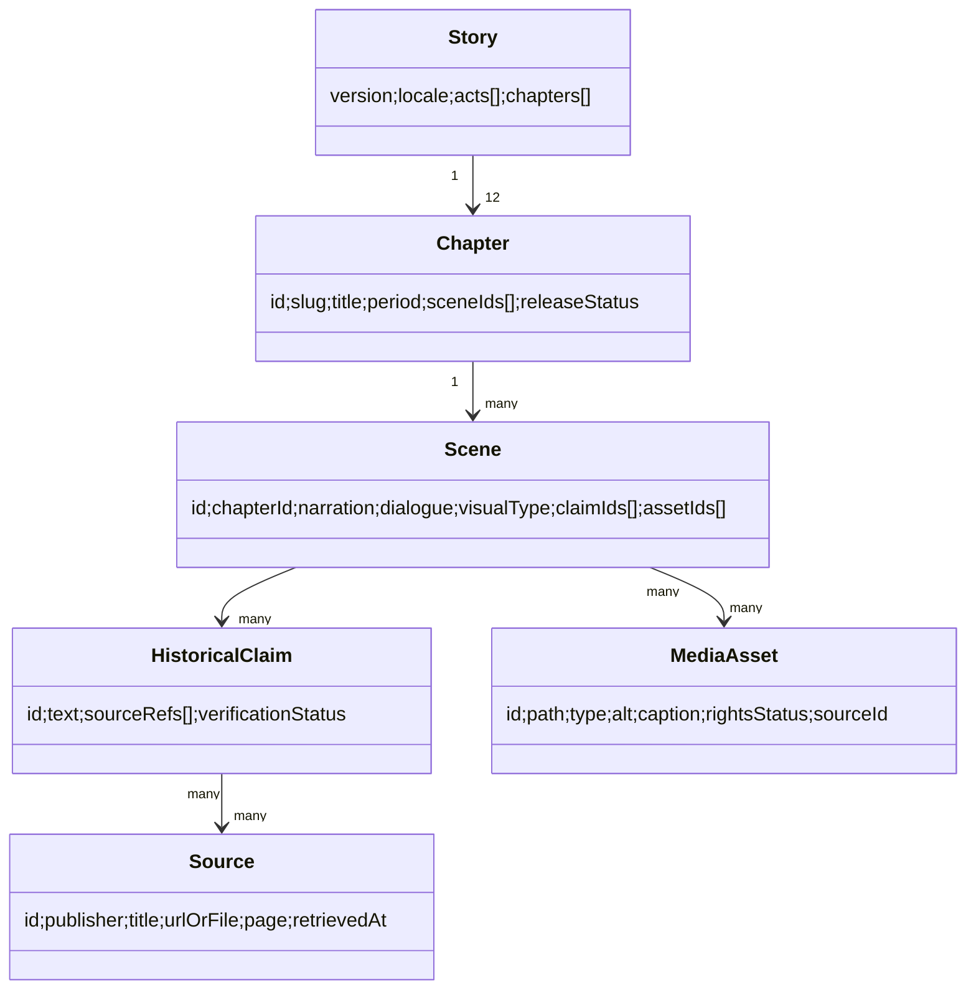

# NGÀY MAI, MÌNH SẼ…
## Technical Implementation Specification — High Level → Low Level

**Document ID:** NMMS-TECH-001  
**Version:** 1.0  
**Date:** 03/11/2026  
**Status:** Ready for developer estimation and architecture review; **not** an assertion that all historical claims or media are release-approved.  
**Owner:** Project team  
**Audience:** Tech Lead, Frontend Engineer, UI/UX, Motion Designer, Content Editor, Historical Reviewer, QA, DevOps

> **Source of truth for narration/dialogue:** `Ngay_Mai_Minh_Se_Proposal_Kich_Ban_Chi_Tiet_v1.0.docx` (script, 12 chapters, 55 scenes). This implementation document defines how to build that script as a web experience. It does not revise historical claims or replace editorial review.

### Document change log

| Version | Date | Changes | Status |
|---|---|---|---|
| 1.0 | 03/11/2026 | Initial HLD + LLD, scope, content contracts, routing, state, scene engine, quality gates, QA/AC | Draft for technical sign-off |

---

# 1. Project definition and decisions

## 1.1 Product statement

Build a **Vietnamese-language cinematic storytelling website** combining a 2026 mother–child narrative frame, historical explanatory narration and a split-screen section during 1954–1975. The user reads or listens and scrolls through a coherent story spanning 1930–2026. The product must remain a **story**: **no museum navigation, no quiz, no role-playing game, no leaderboard**.

Success means viewers can follow the story from Prologue → Hồi I → Hồi II → Hồi III → Epilogue; historical context remains legible and sourceable; the experience works on modest mobile devices, keyboard-only navigation and reduced-motion settings.

## 1.2 Inputs, truth boundaries and scope freeze

**Already available:** 35-page source DOCX/PDF story proposal, 55 scene headings with narration, fictional dialogues, visual and sound directions, and historical caveats; 29-page course notes and 219-page 2019 textbook PDF. The supplied `content/story_manifest.v1.json` extracts 55 scenes from the DOCX and is a **DRAFT content seed**, not a fact-checked release package.

**Not yet supplied:** verified/cleared media files, recorded voice-over, definitive historical claims register at line/scene level, brand visual design files, domain/hosting credentials, analytics consent policy, academic reviewer sign-off. Developer must implement placeholders and validation gates; must **not** invent historic photos, direct quotes, speeches or citations.

## 1.3 In scope (Release 1)

1. Landing / Prologue, continuous 12-chapter sequence and Epilogue.
2. Chapter view with scene progression; 55 scenes from story manifest; responsive layout.
3. Subtle scroll transitions, text reveal, selective timelines, one split-screen chapter layout for Chapters 07–08.
4. Optional pre-recorded narration (only when licensed audio exists), user-initiated playback, mute, volume, playback state; readable narration always present.
5. Full reading mode and transcript; accessible source and historical-reconstruction disclosure.
6. Chapter navigation, “continue from scene” via URL hash, progress indicators, back/next navigation.
7. Media integrity: captions, alt text, license and provenance register.
8. Build-time content validation, unit tests, E2E checks, CI and static hosting deployment.
9. Source directory with documentation links and user-facing factual notes.
10. Graceful degradation for missing optional images, audio, animation and network hiccups.

## 1.4 Out of scope (Release 1)

- Server-side content management, multi-user accounts, login, profiles and a database.
- Public comments, cloud-submitted letters, moderation, dashboards and email delivery.
- Real-time collaborative viewing, gameshow, quizzes and achievements.
- Free-form LLM chat, TTS voice clone, live generated historical dialogue.
- Full 3D world, gameplay engine, heavy video-by-default, automatic AI image sourcing.
- Full translation/multilingual dubbing (architecture prepares locale field only).

**Phase 2 options:** optional CMS workflow; moderated public messages; collection of analytics with consent; multilingual scripts. Each requires a separate security/privacy and API design review.

## 1.5 Functional requirements (FR)

| ID | Requirement | Priority | Release evidence |
|---|---|---|---|
| FR-01 | All 55 source scenes display in approved order with stable IDs | P0 | Automated manifest test + manual walkthrough |
| FR-02 | Scene narration and dialogues rendered without loss and with fiction label | P0 | Content snapshot and reviewer check |
| FR-03 | Chapter navigation and deep-link to `#C07_S03` | P0 | E2E deep-link test |
| FR-04 | Scroll-driven visuals never block reading | P0 | JS-disabled/read mode + mobile check |
| FR-05 | Chapters 07–08 show concurrent North/South context on wide screens | P0 | Desktop split-screen scenarios |
| FR-06 | Same pair of timelines is readable sequentially on phones | P0 | 375px and 390px tests |
| FR-07 | Audio starts only after user's action; captions/transcript always exist | P0 | Browser audio and accessibility QA |
| FR-08 | Source notes are clearly distinguishable from fictional dialogue | P0 | Academic review checklist |
| FR-09 | Resume by URL hash works without user account | P1 | Reload/back/forward QA |
| FR-10 | End-of-story reflection is local-only or copyable; no submission | P1 | Privacy and offline tests |
| FR-11 | Chapter and scene content editable via version-controlled JSON | P0 | Schema validation CI |
| FR-12 | Missing assets show designed fallback and log dev build warning | P0 | Asset failure tests |

## 1.6 Nonfunctional requirements (NFR)

| ID | Target / requirement | Verification |
|---|---|---|
| NFR-01 | Mobile-first, minimum supported design width 320 CSS px; target 375+, 768+, 1280+ | Responsive QA |
| NFR-02 | WCAG 2.2 AA as target for text, navigation, focus, media alternatives | axe automated + manual keyboard review |
| NFR-03 | Reduced-motion mode: zero essential motion; content remains complete | OS setting + toggle QA |
| NFR-04 | Performance target: LCP ≤2.5s, CLS ≤0.1, INP ≤200ms at p75 on representative deployment | Real-user measurement after launch; lab budget before release |
| NFR-05 | Initial route must not download all narration audio/video assets | Network waterfall and asset budgets |
| NFR-06 | No personal data collection or third-party trackers by default | Network/privacy inspection |
| NFR-07 | Release build fails on schema errors, dangling asset IDs or historical claims missing required status | CI validation |
| NFR-08 | Site fully functional as text when audio disabled and images fail | Fallback QA |
| NFR-09 | Vietnamese font and diacritic correctness on all supported browsers | Visual comparison and locale review |
| NFR-10 | Build reproducible with pinned lockfile, CI and rollback | Repeat-build check |

Performance numbers are engineering **targets to validate**, not claims of current achieved performance.

## 1.7 Decisions / assumptions

| ID | Decision | Rationale | Change trigger |
|---|---|---|---|
| D-01 | **Next.js App Router + TypeScript** | Static SEO-friendly chapter HTML, established React composition | Hosting or team constraints |
| D-02 | **`output: 'export'`** for R1 | No runtime server/API, deploy to CDN/static host | Server features required |
| D-03 | Version-controlled JSON content | 55 scripted scenes; editorial audit trail | Editor needs GUI CMS |
| D-04 | GSAP + ScrollTrigger **only for motion** | Precise scroll progression, cleanup and responsive motion | Simpler CSS-only motion proven sufficient |
| D-05 | Native `<audio>` with one global audio controller | Browser policy compatibility and lower complexity | Need audio crossfades/mixing |
| D-06 | CSS Grid for split-screen | Semantically ordered content and mobile adaptation | Special illustration requirements |
| D-07 | Images default to static assets (AVIF/WebP/JPEG variants) | Static hosting and caching | Existing image CDN selected |
| D-08 | No backend, no cookies, no cloud letters in R1 | Privacy and delivery simplicity | User submissions approved |
| D-09 | Timeline logic is **not** simulated history | Historical timeline cannot branch based on choices | Academic scope change |

**Next.js static limitation:** `output:'export'` cannot use server actions, runtime cookies, rewrites, default server image optimization or dynamic handlers that require an incoming request. Use static route generation and explicit image optimization at build time. Official: https://nextjs.org/docs/app/guides/static-exports.

---

# 2. Information architecture and user flows

## 2.1 Navigation hierarchy

```text
/                       Home + narrative prologue teaser + Start
/story/                 Index: 3 acts and 12 chapters, continue/reader options
/story/chapter/[slug]/  One canonical, pre-rendered chapter page (01–12)
/story/ending/          Epilogue + final reflection (local-only)
/transcript/            Complete accessible text, grouped by chapter
/sources/               Historical source register and editorial disclosures
/about/                 Project, method, attribution and privacy information
```

**Design requirement:** The index must read like a book's chapters, **not** a museum artifact grid. The visual hierarchy emphasizes narrative continuity and a single “Continue story” action. Users can read all chapters out of order without losing historical context.

## 2.2 Primary happy path



## 2.3 Critical alternate journeys

- **Direct link:** `/story/chapter/07-hai-nua-cua-mot-bau-troi/#C07_S03` loads chapter then scrolls/focuses Scene C07_S03, while preserving a visible chapter heading.
- **No audio permission:** everything stays readable; an explicit Play control is shown and can fail without blocking the story.
- **Slow connection:** first paint contains chapter title and readable text; images have static placeholders and lazy-load; auto-audio never starts.
- **Reduced motion:** still images with cuts/fades only if permitted, no sticky scroll traps; navigation remains identical.
- **Small viewport:** a split-screen chronology becomes alternated North/South panels with the same period labels and narrative order.
- **Keyboard/screen reader:** headings, `<main>`, `<section>`, anchors and buttons; animated layers do not steal focus.
- **Back/forward:** browser URL is canonical; scroll-based scene changes should not spam history entries.

---

# 3. High-level architecture (HLD)


## 3.1 Logical layers

1. **Build-time content layer:** the approved source narrative is parsed into machine-readable scenes, linked to claims, sources and licensed media. A validation pipeline rejects broken content.
2. **Static delivery layer:** pre-rendered Next.js pages, bundled client-side JS and optimized assets served via CDN over HTTPS.
3. **Presentation layer:** `StoryShell`, `ChapterRenderer`, `SceneBlock`, chapter-specific renderers and a text-first reading fallback.
4. **Interaction layer:** browser scroll, user controls, view preferences, navigation, deep link, a11y preferences. No user accounts.
5. **Media layer:** images, captions, optional recorded narration and subtitles/transcript; never invent or scrape media on the client.
6. **Quality layer:** content validation, tests, accessibility, media license check, academic sign-off and deployment rollback.

## 3.2 Runtime request flow

```mermaid
sequenceDiagram
  actor U as Viewer
  participant CDN as CDN
  participant N as Next static HTML
  participant C as Story client layer
  participant M as Media assets
  U->>CDN: GET /story/chapter/07.../
  CDN-->>U: HTML + cached JS/CSS
  U->>C: Hydrate controls after first readable paint
  C->>C: Detect viewport and reduced-motion
  C->>C: Register scene visibility observers
  C->>M: Request visible/next image only
  M-->>C: Image or fallback
  U->>C: Click 'Play narration' (optional)
  C->>M: Request specific approved audio
  M-->>C: Audio stream or playback failure
  U->>C: Scroll to scene C07_S03
  C->>C: Update current scene UI, not history every frame
```



## 3.3 Historical content publishing flow


**Two mandatory sign-offs:** `editor_approved` for script wording + `historian_approved` for claims/sources. Media additionally requires `rights_approved`. Deployment fails if any required field remains `draft` or `pending` in production build, although the dev/staging build must accept placeholders and show status prominently.

## 3.4 Deployment architecture

- Source repository → CI tests and historical content checks → Next static export → versioned artifact → CDN/static host.
- Separate `staging` and `production` environments; preview builds use watermark “BẢN NHÁP / CHƯA THẨM ĐỊNH”.
- Secrets used for CI only; no API key exposed in client bundles; production site has no database credentials.
- Release rollback by redeploying prior immutable build artifact.
- Cache static fingerprinted assets for long periods; HTML short-lived or revalidated at publish.

---

# 4. Low-level architecture (LLD): project structure

```text
src/
  app/
    layout.tsx                        # metadata, navigation, accessibility shell
    page.tsx                          # landing/prologue teaser
    story/page.tsx                    # table of contents (narrative, not museum)
    story/chapter/[slug]/page.tsx     # generateStaticParams + chapter renderer
    story/ending/page.tsx
    transcript/page.tsx
    sources/page.tsx
    about/page.tsx
    globals.css
  components/
    layout/TopBar.tsx
    layout/ChapterNav.tsx
    story/StoryShell.tsx
    story/SceneBlock.tsx
    story/SceneMedia.tsx
    story/Dialogue.tsx
    story/HistoricalContext.tsx
    story/SourceFootnote.tsx
    story/SceneProgress.tsx
    story/ActDivider.tsx
    story/ChapterTransition.tsx
    story/SplitTimelineScene.tsx
    story/TranscriptView.tsx
    controls/ReaderToggle.tsx
    controls/SoundControl.tsx
    controls/MotionToggle.tsx
  hooks/
    useActiveScene.ts
    useStoryPreferences.ts
    useNarration.ts
    useReducedMotion.ts
    useHashNavigation.ts
  lib/
    content/loadStory.ts
    content/validateStory.ts
    content/resolveSources.ts
    content/selectChapter.ts
    assets/mediaRegistry.ts
    motion/scenePresets.ts
    audio/narrationController.ts
  styles/
    tokens.css
    scene.css
    motion.css
  types/
    story.ts
content/
  story_manifest.v1.json
  chapters.json
  historical_claims.json
  source_registry.json
  media_registry.json
  release_metadata.json
public/
  media/photos/         # only files with verified rights
  media/illustrations/  # mark reconstruction
  media/audio/          # per-scene or per-chapter narration
scripts/
  validate-content.ts
  validate-assets.ts
  generate-transcript.ts
  verify-release.ts
  build-media.mjs
qa/
  acceptance_matrix.csv
  devices.md
```

**Naming:** `C01_S01` through `C12_S04`, `PRO_S01/S02`, `EPI_S01/S02`; never use display index as a permanent scene key. Paths use stable slugs independent of title translations.

---

# 5. Content data model and validation

## 5.1 Entity design



## 5.2 Source manuscript manifest

The included `content/story_manifest.v1.json` is **directly extracted from the script**. It contains 55 scene records with fields:

- `id`, `script_ref`, `title`, `act`, `chapter_id`, `chapter_title`, `period_label`
- `narration`, `dialogue_fiction`, `visual_direction`, `audio_direction`, `motion_direction`
- `historical_notes`, `historical_claim_ids`, `assets`, `status`, `source_doc`

This is a content migration aid. The words `narration` and `dialogue_fiction` must be reviewed against the approved Word script before production. `historical_claim_ids` and `assets` are empty on purpose because individual historical verification and media rights were not supplied.

## 5.3 Recommended production contracts (TypeScript)

See `schemas/story.ts` in bundle for actual type definitions and Zod validation. Essential structure:

```ts
type SceneId = `C${string}_S${string}` | 'PRO_S01' | 'PRO_S02' | 'EPI_S01' | 'EPI_S02';
interface Scene {
  id: SceneId;
  chapterId: string | null;
  title: string;
  narrative: { narrator: string; dialogue: DialogueLine[] };
  presentation: { template: 'cinematic'|'split'|'timeline'|'document'|'plain'; mediaIds: string[]; motionPreset: string };
  history: { claimIds: string[]; fictionDisclosure: boolean };
  status: 'draft' | 'editor_approved' | 'historian_approved' | 'published';
}
```

**Mapping:** extracted `narration` → `narrative.narrator`, `dialogue_fiction` → structured lines after editorial labeling, `assets` → `presentation.mediaIds`, each factual sentence → one/more explicit `history.claimIds`.

## 5.4 Source register (REQUIRED, new authoring task)

`source_registry.json` fields: `source_id`, `title`, `publisher`, `author?`, `published_at?`, `url?`, `file_name?`, `page_start?`, `page_end?`, `accessed_at?`, `evidence_excerpt?`, `license?`. Do not put an academic citation like “giáo trình” alone if precise pages are available.

`historical_claims.json` fields: `claim_id`, `statement`, `period`, `source_ids[]`, `evidence_pages[]`, `verification_status`, `verified_by`, `verified_at`, `notes`. Multiple verified sources are recommended for less well-known anecdotes or disputed details.

**Release gate rules:**

```text
IF production AND a historical claim has no verified source → FAIL BUILD
IF a scene references a nonexistent source/claim/media → FAIL BUILD
IF historical audio/image exists but rights != approved → FAIL BUILD
IF reconstruction not visibly labeled → FAIL BUILD
IF direct historical quote has no original source/page → FAIL BUILD
```

## 5.5 Media registry

Fields: `asset_id`, `file_path`, `kind` (photo, illustration, video, audio), `created_by`, `origin_url`, `captured_date`, `historical_date`, `license`, `rights_status`, `credit`, `alt_vi`, `caption_vi`, `is_reconstruction`, `aspect_ratio`, `transcript_path` (if applicable), `poster_path` (for video), `dominant_color`. A copyright citation alone does **not** grant permission to display an image.

## 5.6 Chapter coverage map

| App chapter | Course stage | Canonical period | Distinct renderer |
|---|---|---|---|
| C01 | I / formation | Pre-1930–1930 | Illustrated timeline + archival document motifs |
| C02 | I / 1930–1935 | 1930–1935 | Standard cinematic scenes |
| C03 | I / democratic movement | 1936–1939 | Editorial newspaper typography (reconstruction label) |
| C04 | I / independence | 1939–1945 | Countdown/timeline (non-branching) |
| C05 | II / new government | 1945–1946 | Everyday-life narrative |
| C06 | II / first resistance | 1946–1954 | Logistics and timeline modules |
| C07 | II / North and South | 1954–1965 | **Split-screen** North/South |
| C08 | II / national struggle | 1965–1975 | **Split-screen** + convergence |
| C09 | III / post-war | 1975–1981 | Side-by-side restoration scenes |
| C10 | III / search for reform | 1981–1986 | Before/after policies (non-fabricated data) |
| C11 | III / reform & integration | 1986–2007 | Dynamic-but-readable chronological cards |
| C12 | III / recent decades | 2007–2026 | Contemporary video/stills, timeline |

---

# 6. Scene rendering engine LLD

## 6.1 Data-to-component rendering

`ChapterRenderer` loads a validated `Chapter` and ordered `Scene[]`, emits one semantic `<article>` with `<h1>`, then `<section id={scene.id}>` containing narration, optional dialogue, media and citations. Scene types select visual templates; semantics always originate from common `SceneBlock`.

**Component rules:**

- A scene always has a visible heading and narration; animation is progressive enhancement.
- Scene text must exist in the DOM before animation; never inject historical text through GSAP.
- Source footnotes are accessible links; fiction disclosure appears with fictional dialogue and reconstructed images.
- No sticky-scene fixed height on mobile that clips long Vietnamese text.
- Use CSS `content-visibility` carefully; do not hide text from assistive tech or break anchor navigation.
- Dynamic portions are client components only where browser APIs are required.

## 6.2 Scene active-state algorithm

1. Render chapter text and scenes as static HTML.
2. After hydration, use `IntersectionObserver` with a threshold or center-biased rootMargin to determine `activeSceneId`; fallback to scroll-position computation for very tall scenes.
3. Debounce only the UI progress update, not keyboard focus; no `pushState` on every scroll frame.
4. On explicit “Copy link to scene”, set `location.hash = scene.id`; on chapter load, honor hash after fonts/layout stabilization.
5. Expose `activeSceneId` to timeline and audio controls; do not automatically start or advance audio.
6. In `Reader Mode`, disable observer-driven sticky visual effects; keep normal article flow.

**Edge cases:** chapter deep-link before image loaded; React strict mode effect cleanup; resize/orientation changes; browser back; tab hidden; mousewheel with trackpad; long dialogue blocks; reduced motion toggled mid-chapter.

## 6.3 Motion presets

| Preset | Use | Desktop behavior | Mobile / reduced motion |
|---|---|---|---|
| `fade-in` | Narrative reveal | Opacity + 16px translate | Opacity only / none |
| `chapter-cut` | Section boundary | Crossfade + title | Instant content change in read mode |
| `split-sync` | C07–C08 | Two simultaneous panels with shared time markers | Alternate panels: NORTH then SOUTH per shared year |
| `timeline-reveal` | Dates | Reveal line and markers | Static vertical timeline |
| `map-step` | Verified routes | Highlight known route segments | Static map and descriptive list |
| `convergence` | April 1975 transition | Two panels converge without covering narration | Single centered heading |

Use `gsap.context()` or `gsap.matchMedia()` and `.revert()` in cleanup. Never attach scroll triggers twice on rerender. Motion not supported/disabled must NOT change content order.

## 6.4 Split-screen specification (Chapters 07–08)

**Desktop ≥1024px:** CSS grid `grid-template-columns: minmax(0,1fr) minmax(0,1fr)` with 24px gutter; each panel has independently labeled `MIỀN BẮC` / `MIỀN NAM`. Display **shared year marker** above two views. Story text is read in a deliberate order via DOM: time intro → North → South → shared interpretation. CSS visual order may put the panels side-by-side; source DOM reading order is fixed.

**Tablet 768–1023px:** two columns only if text and images remain readable; otherwise stack.

**Phone <768px:** chronological pairs become rows: year title → North card → South card → short bridge. No horizontal scroll or tiny overlay text; preserve both viewpoints equally.

**End of C08:** use color/visual convergence as a metaphor, explicitly avoid implying every family reunited immediately in 1975. A historically grounded end card separately notes 1976 state unification.

**AC:** At 375px, viewers can distinguish side and year without relying solely on color; keyboard reads North before South; no overlapping captions; no missing text relative to desktop.

## 6.5 Audio module

**Principle:** reading is primary; VO is an enhancement. A single global narration controller owns `HTMLAudioElement` state. Required states: `idle`, `loading`, `playing`, `paused`, `ended`, `error`. Events: `PLAY_REQUEST`, `PAUSE`, `RESUME`, `SEEK`, `TRACK_END`, `ERROR`, `CHAPTER_CHANGE`, `VISIBILITY_HIDDEN`.

- Audio plays only after explicit user click/tap. Browsers may block sound without a gesture; handle `play()` rejected Promise with readable inline guidance. See https://developer.mozilla.org/en-US/docs/Web/Media/Guides/Autoplay.
- One approved narration asset per scene is recommended for consistent seek/resume; missing asset means text-only scene, not generated voice.
- When user scrolls away while playing, **do not secretly switch audio**. Show “Đang nghe cảnh X”; offer Follow Scene or Next Track explicitly.
- Pausing and seeking never force user scroll unless the user chooses a “Follow narration” button.
- No autoplay on chapter navigation. No automatic “dramatic background audio” that competes with narration.
- `aria-label` for controls; visible playback state; transcripts persist.
- If embedded videos exist, captions must be authored and reviewed.

## 6.6 Reader mode and accessible fallback

- Reader toggle produces plain semantic article with headings, dates, captions, citations and dialogue labels.
- No sticky/fixed panels, auto transitions, custom wheel hijack or hidden narration.
- Link to transcript from each chapter and a full `/transcript/` page.
- All interactive controls keyboard reachable; focus visibly styled and restore focus appropriately after modal closure.
- Decorative imagery `alt=""`; informative photos have exact descriptive alt plus visible source caption.
- Never rely on color alone to distinguish time periods or North/South.
- Respect `prefers-reduced-motion` OS and explicit site toggle; toggling uses the least-motion choice.

---

# 7. Component-level contracts

## 7.1 `StoryShell`

**Props:** `chapter`, `scenes`, `readingMode`, `onModeChange`. **Responsibilities:** headings, chapter navigation, active scene progress, media controls, source-link footer. **State:** active scene ID only; do not duplicate the entire content store in React state.

## 7.2 `SceneBlock`

**Props:** `scene`, `template`, `isActive`, `motionEnabled`. **Render:** `<section id>`, `<h2>`, approved text, `Dialogue`, `SceneMedia`, `HistoricalContext` and source links. **Invariant:** identical narration text in animated and reader modes.

## 7.3 `SplitTimelineScene`

**Props:** `north`, `south`, `sharedYear`, `bridgeText`, `assets`. **Render:** a single semantic time segment containing both regions. **Invariant:** pairs must be aligned to documented years/periods; no inferred simultaneity for anecdotes without dates.

## 7.4 `HistoricalContext` and `SourceFootnote`

**Props:** `claimIds[]`, resolved source registry. **Render:** a compact “Bối cảnh lịch sử” panel and cited sources with page or URL. **Invariant:** source IDs must resolve; if user-facing long academic notes disrupt narrative they may be in collapsible `<details>` that remain keyboard accessible.

## 7.5 `SoundControl`

**Props:** `audioState`, `availableTrack`, `onPlay`, `onPause`, `onSeek`, `onVolume`. **Invariant:** missing audio hides Play (show “Chưa có bản đọc”); autoplay never attempted outside user gesture.

## 7.6 `ReaderToggle`

**Props:** `value`, `onChange`. **Invariant:** changes presentation only, never changes facts or order of text.

## 7.7 `ChapterTransition`

**Props:** `fromChapterId`, `toChapterId`, `bridgeText`. **Invariant:** copy the transition dialogue verbatim from approved script; no algorithmic generation of historical bridges.

---

# 8. State, persistence, URL and navigation

| State | Scope | Persistence | Notes |
|---|---|---|---|
| `chapterId` | URL route | URL | source of truth |
| `sceneId` | URL hash / observer | hash on explicit navigation | `#C07_S03`; no history spam |
| `activeSceneId` | chapter runtime | memory | computed; safe for SSR |
| `readingMode` | user preference | localStorage optional | first access after hydration |
| `reducedMotionOverride` | user preference | localStorage optional | OS preference always supported |
| `audioState` | tab session | memory | no resume across devices |
| `volume` | user preference | localStorage optional | do not auto-play despite stored preference |
| `reflectionText` | ending | session memory | provide Copy; do not send server |

**Privacy note:** localStorage is not a backend but still a browser-side data store; do not store sensitive free-text by default. The Epilogue reflection may remain only in React state until user copies/downloads it.

**URL standard:** each chapter has one canonical path; use anchors for scenes, no query parameters that change historical sequence. `generateStaticParams` enumerates exactly 12 slugs so static export is valid.

---

# 9. Visual/UI design specification

## 9.1 Art direction

- Concept: editorial documentary with intimate, cinematic typography; no digital museum floor plans, artifact inventory, game dashboard or neon HUD.
- Type: reliable Vietnamese-supported family (e.g. system UI/Inter for UI; a Vietnamese-capable serif for chapter pull quotes). Use legally distributed fonts and self-host if approved.
- Color palettes: warm neutral text-first; accent colors by act, sufficient contrast (AA). Color is symbolic only, never the sole history cue.
- Images: photos have visible provenance; illustrations have “Tái dựng minh họa”. Do not present a generic AI portrait as a photographed historical person.
- Transitions: deliberate and quiet; narrative content takes precedence over ornament.

## 9.2 Layout tokens (initial design values; UX owner may adjust)

| Token | Suggested value |
|---|---|
| `--content-width` | 760px text max |
| `--wide-width` | 1200px split width |
| `--page-gutter` | clamp(16px, 4vw, 48px) |
| `--body-size` | clamp(17px, 1.2vw, 19px) |
| `--line-height` | 1.65–1.8 |
| `--scene-space` | 64–112px depending on content |
| `--focus-ring` | 3px clearly visible |
| `--hit-target` | >=44x44 CSS px preferred |
| `--sticky-nav-height` | <=72px mobile |

**Beware:** no 100vh fixed story overlay on mobile; text length varies significantly in Vietnamese.

## 9.3 Page-level composition

**Home:** a strong ordinary-day hook, one prominent “Bắt đầu câu chuyện” CTA, optional two-line disclaimer, three-act preview. **Story index:** chronological chapter list with 1930/1945/1975/1986/2026 anchors. **Chapter:** heading, question, scene text, selective media, progress and bridge. **Transcript:** clean print-friendly text, numbered scenes. **Sources:** accessible claim/source lookup; explicit distinction between source and fictional lines. **Ending:** local-only reflection + link to transcript and source methods.

---

# 10. Integration and APIs

## 10.1 Release 1 API decision

**There are NO business APIs in Release 1.** All story, source and media metadata ship as versioned static JSON. A runtime backend and database are unwarranted until an explicitly approved feature needs persistent server state. Do not build unused `/api/*` placeholders or expose credentials.

Example data flow:

```text
content JSON → validate at build → static chapter HTML + JSON chunks
public/media → optimized assets → CDN → browser
user click/audio/scroll → in-memory state only
```

## 10.2 Optional Phase 2 API (not to be implemented without approval)

Potential public reflection feature:

```http
POST /api/reflections
Content-Type: application/json
{"message":"...","consent":true,"locale":"vi-VN"}
```

Only if needed, design abuse prevention, moderation and user consent. Proposed response: `{ "id": "...", "status": "pending_moderation" }`. **Do not assume messages are immediately public.** Required: moderation queue, abuse thresholds, deletion policy, rate limiting, CSRF/origin policy, sanitized rendering, data retention, privacy notice. No API is active in R1.

---

# 11. Asset and content production workflow

## 11.1 Media list per scene

The source script's `visual_direction` is a **brief**, not a cleared asset. Content team creates an `asset_requirements.csv` (one or more per scene) with: `scene_id`, `shot_description`, `type`, `origin_candidate`, `historical_accuracy_constraints`, `requires_rights`, `license_status`, `approved_by`, `asset_id`, `alt_vi`, `caption_vi`.

## 11.2 Filename convention

`C07_S02_photo_01_v01.webp`, `C07_S02_illustration_v01.avif`, `C07_S02_vo_vi_v01.mp3`, with an immutable asset ID independent of filename. Media accessible only if license status allows distribution.

## 11.3 Asset optimization

- Convert large historical photos to approved WebP/AVIF derivatives; retain accessible resolution if document details need zoom.
- Preserve archive credits, keep original externally or in private asset store rather than distributing unlicensed master.
- Image sizes/responsive `srcset`, explicit width/height and lazy loading; prioritize only hero/LCP image.
- Audio per-scene with human-reviewed transcript; don't bulk preload all 55 tracks.
- No client-time fetching of live remote historical articles for page content; pin and document sources.

## 11.4 Content release checklist

Editor approves prose → historian checks claims/chronology → legal/media reviewer approves rights → developer runs content schema and E2E → QA signs off → release manager deploys. Each failure produces a blocking issue; no silent fallback to fabricated dates or anonymous sources.

---

# 12. QA and testing

## 12.1 Test pyramid

**Unit (Vitest):** schema parse, slug uniqueness, scene ordering, source cross-reference, chapter mapping, historical quote rules, local preference behavior, audio state transitions. **Component (React Testing Library):** SceneBlock text present, controls keyboard reachable, fiction labels, side-by-side chronological group. **E2E (Playwright):** route navigation, direct hash links, 375px split-screen, audio play rejection, reduced-motion, missing asset, reader mode, offline/static pages. **Manual:** Vietnamese font, historical fact-check, contrast, screen readers, iOS Safari and Android Chrome.

## 12.2 Minimum supported test matrix

| Class | Target |
|---|---|
| Phone small | 320×568, 375×667 |
| Phone mainstream | 390×844, 430×932 |
| Tablet | 768×1024 |
| Desktop | 1280×800, 1440×900 |
| Browsers | Current Chrome, Firefox, Edge, Safari; iOS Safari and Android Chrome |
| Inputs | Touch, pointer, keyboard, screen reader |
| Modes | Default, reduced motion, reader, no sound, no images, JS disabled |

## 12.3 Acceptance criteria (Gherkin-style summary)

| AC | Given / When / Then |
|---|---|
| AC-01 | Given approved content, when build runs, then 12 chapters and 55 scenes exist in expected order |
| AC-02 | Given a scene, when animations are disabled, then its narration/dialogue/notes remain visible and unchanged |
| AC-03 | Given `/story/chapter/07.../#C07_S03`, when page loads, then scene C07_S03 is reachable and announced |
| AC-04 | Given mobile 375px, when chapter 07 renders, then North and South panels are distinct, in shared chronological order |
| AC-05 | Given prefers-reduced-motion, when navigating, then sticky motion/parallax is disabled without content loss |
| AC-06 | Given user has not clicked Play, when page loads, then no audio is audible or autoplay attempted |
| AC-07 | Given denied media playback, when Play fails, then UI shows readable error and story remains usable |
| AC-08 | Given source registry, when historical claim is published, then the linked source and evidence page are present |
| AC-09 | Given an unapproved image, when release build runs, then it fails rather than shipping image |
| AC-10 | Given a fictional dialogue, when shown, then it is marked as artistic reconstruction / fictional dialogue |
| AC-11 | Given a keyboard-only user, when traversing the story, then all controls and source links are operable |
| AC-12 | Given script source, when transcript generated, then all narration and dialogue content is preserved |
| AC-13 | Given slow 4G, when chapter loads, then first readable text appears without waiting for media assets |
| AC-14 | Given broken image URL, when media fails, then caption/source and alt/fallback remain meaningful |
| AC-15 | Given Phase 1 launch, when inspecting network, then no unapproved user content leaves browser |

**Full QA export:** `qa/acceptance_matrix.csv` adds owner, test steps, evidence and status.

## 12.4 Definition of Done (Release)

- Stories 01–12, Prologue and Epilogue approved as full text; review statuses resolved.
- Scenes and chapter progress work on target mobile and desktop devices.
- Historical claims can be traced to sources (page/URL), and disputes are documented, not silently “fixed”.
- All media publicly served has cleared rights and proper caption/alt.
- No P0/P1 defects; accessibility blockers resolved; reduced-motion, transcript and reader mode verified.
- `lint`, `typecheck`, `test`, content validation, `build`, E2E and smoke test pass in CI.
- Release artifact stored, deployed on staging, QA evidence attached, production release approved, rollback path proven.

---

# 13. Delivery work breakdown structure (WBS)

**Important:** durations are relative estimates for planning, not committed delivery dates. Assume 1 FE lead, 1 FE engineer, fractional UI/motion, historian/editor and QA; media licensing and review can be the critical path.

| Sprint / phase | Outcome | Development tasks | Evidence / DoD |
|---|---|---|---|
| P0 / Discovery (2–4 days) | Scope and content contract frozen | Audit 55 scenes; reconcile story IDs; review HLD/LLD; media inventory; choose host | Signed scope, backlog, architecture decisions |
| P1 / Foundation (4–6 days) | Build runs with first 2 scenes | Next project, base tokens, routing, Zod, CI, static export, reader shell | Staging preview, build validation pass |
| P2 / Story engine (5–8 days) | All 55 scenes render text-first | `SceneBlock`, chapter render, source module, timeline, progress, hash navigation | Full text site with script parity checks |
| P3 / Cinematic UX (5–8 days) | Selected scenes animated safely | Scene presets, image loading, chapter transitions, responsive states | Desktop/mobile motion QA; reduced motion pass |
| P4 / Split-screen + audio (4–7 days) | Signature storytelling and approved VO | C07–C08 split, audio controller, transcript, media controls | Mobile alternative, audio-error QA |
| P5 / Content and release (5–10+ days) | Approved assets/facts and launch gate | Source claim mapping, rights, performance, E2E, academic review, deploy | Fact-check sign-off, rights audit, release report |

The exact schedule depends on approved media and fact-check turnaround, not only code effort. Parallelize content approval and engineering, but do not treat missing approval as a completed task.

## 13.1 Prioritized backlog / work items

| ID | Deliverable | Priority | Dependencies |
|---|---|---|---|
| DEV-001 | App shell and 12 statically generated routes | P0 | D-01/D-02 |
| DEV-002 | Story manifest schema and 55-scene import | P0 | Source Word script |
| DEV-003 | Chapter and scene renderer | P0 | DEV-001/002 |
| DEV-004 | Reader mode / transcript / citations | P0 | DEV-003 |
| DEV-005 | Historical claim registry and build gate | P0 | Reviewer input |
| DEV-006 | Media metadata and license gate | P0 | Rights team input |
| DEV-007 | Responsive cinematic motion presets | P1 | DEV-003 |
| DEV-008 | Split timelines C07/C08 | P0 | DEV-003; historical dates approved |
| DEV-009 | Audio controller / subtitle UX | P1 | Audio recorded / approved |
| DEV-010 | Deep link / scene progress / bookmarks | P1 | DEV-003 |
| DEV-011 | CI, static deploy, rollback | P0 | DEV-001 |
| DEV-012 | E2E, accessibility, performance release gate | P0 | DEV-003–011 |

A detailed importable backlog is supplied in `qa/backlog.csv`.

---

# 14. Roles, approvals and RACI

| Deliverable | Product / PM | Historical reviewer | Content writer | FE / TL | QA |
|---|---|---|---|---|---|
| Scope + architecture | A | C | C | R | C |
| Script lock + narrative continuity | A | C | R | C | I |
| Historical claim verification | I | A/R | R | C | C |
| Asset rights and attribution | A | C | R | C | C |
| Scene runtime and split UI | C | C | C | A/R | C |
| Accessibility, compatibility | A | I | C | R | R |
| Final content release sign-off | A | R | R | C | C |

`A` accountable, `R` responsible, `C` consulted, `I` informed. PM must nominate real people; no approvals have been granted in this document.

---

# 15. Risks, alternatives, open decisions

| ID | Risk | Mitigation / decision needed | Severity |
|---|---|---|---|
| R-01 | Script narration and fact claims have no per-sentence source mapping | Content team creates claim register; production gate fails until reviewed | Critical |
| R-02 | Photos / recordings lack redistribution rights | Use licensed sources, own original illustrations, or text-only fallback | Critical |
| R-03 | Split-screen visually impressive but hard to read on phones | Mobile chronological alternation and reader mode | High |
| R-04 | Scroll animation creates jank or nausea | Progressive enhancement and reduced-motion, budgets and E2E | High |
| R-05 | Audio/autoplay blocked on iOS Safari | User gesture, fallback and no autoplay | High |
| R-06 | “1930–2026” oversells source textbook coverage | Label 2026 section separately with current official sources and review | High |
| R-07 | Very long total experience loses audience | Chapter lengths and “short path” require separate editorial sign-off; no truncation of academic essentials | Medium |
| R-08 | Historical fiction mistaken for direct testimony | Consistent labels and editorial rules | High |
| R-09 | Static export later needs submissions/CMS | Isolate content interfaces; plan migration when Phase 2 approved | Medium |
| R-10 | Performance budget impossible with heavy film imagery | Budget image/video, defer decorative media, fallback stills | Medium |

## Open decisions before Sprint P1

1. **Approved host and domain:** Cloudflare Pages / Vercel static / existing school infrastructure? (No decision supplied.)
2. **Narration assets:** human VO already available, outsourced, or text-only R1? Default text-only until assets supplied.
3. **Academic reviewer:** named owner + acceptance workflow for claims.
4. **Photo rights:** which source archives can supply redistributable images? No assumptions of free reuse.
5. **Brand/design assets:** approved logo, colors, fonts and illustration direction.
6. **End reflection:** local-only by default; public sharing needs Phase 2 requirements.
7. **Short/long paths:** a 25–35 min abridgment must be independently approved, since the full 55 scenes are 55–75 min in source proposal.

The technical architecture can proceed with these open points, but public release cannot bypass academic or media approval.

---

# 16. Engineering handoff: first pull request and commands

## 16.1 Repository setup

Recommended prerequisites: active LTS Node.js and `pnpm` (pinned in repo); CI uses exactly the lockfile versions. Avoid specifying a potentially stale patch release in this document.

```bash
pnpm install --frozen-lockfile
pnpm lint
pnpm typecheck
pnpm test
pnpm content:validate
pnpm build
pnpm e2e
```

**Implementation note:** These are **required target scripts**, not working commands in this documentation bundle; dev must create them in the actual Next.js app. The attached examples are illustrative typed code and content seed, not a compiled application.

## 16.2 First-PR acceptance

- App Router project exists; `output:'export'`, twelve known slugs via `generateStaticParams`.
- A chapter URL renders complete scene text from `story_manifest.v1.json` with stable ID and full title.
- Build status shows `draft` on staging, prevents uncontrolled production release.
- One sample scene supports reader mode, caption, fictional dialogue label and source placeholder.
- Automated test confirms exactly 55 unique scene IDs and no empty narration.
- CI runs typecheck, tests and build.

## 16.3 Example implementation files included

- `content/story_manifest.v1.json`: **55 extracted scenes, full story text**.
- `content/scene_index.csv`: IDs, chapter, title and narration word count.
- `schemas/story.ts`: TypeScript/Zod v1 contracts for raw manuscript and production interfaces.
- `examples/SceneBlock.tsx`: text-first component example.
- `examples/SplitTimelineScene.tsx`: responsive dual-region example.
- `examples/useNarration.ts`: explicit-play audio hook example.
- `qa/acceptance_matrix.csv`: actionable test cases.
- `qa/backlog.csv`: prioritized implementation tickets.

---

# 17. Reference bibliography / external technical standards

**Internal source files:** `Ngay_Mai_Minh_Se_Proposal_Kich_Ban_Chi_Tiet_v1.0.docx`, `ki_9.pdf`, `gt-lich-su-dang-csvn-ban-tuyen-giao-tw.pdf`. These should be uploaded to the project repository under restricted editorial access as appropriate; do not publish them automatically or assume rights for public distribution.

**External technical documentation (checked 03/11/2026):**

1. Next.js App Router static exports — https://nextjs.org/docs/app/guides/static-exports
2. Next.js backend-for-frontend and static limitations — https://nextjs.org/docs/app/guides/backend-for-frontend
3. GSAP `matchMedia()` and media-query cleanup — https://gsap.com/docs/v3/GSAP/gsap.matchMedia%28%29/
4. MDN Autoplay Guide — https://developer.mozilla.org/en-US/docs/Web/Media/Guides/Autoplay
5. WCAG 2.2 — https://www.w3.org/TR/WCAG22/

**Historical governance:** facts and historical quotes must be validated against the course textbooks and qualified official/primary documents, not inferred from imagery or this tech specification.

---

# 18. Final handover checklist

- [ ] Read the source screenplay and confirm 55 scenes match `story_manifest`.
- [ ] Agree R1 in/out scope and target static hosting.
- [ ] Freeze chapter slugs and scene IDs; approve shared TypeScript schema.
- [ ] Select UI kit/tokens and establish one sample scene as visual benchmark.
- [ ] Implement text-first chapter renderer and reader mode before animations.
- [ ] Implement North/South timeline with mobile chronological fallback.
- [ ] Validate narration/audio controls and iOS Safari limitations.
- [ ] Verify all production historical claims, sources and media permissions.
- [ ] Pass automated QA, manual a11y, typography, performance and source checks.
- [ ] Obtain editorial + historical + release-owner sign-offs.
- [ ] Deploy immutable release and keep a tested rollback artifact.

**END — NMMS-TECH-001 v1.0**
